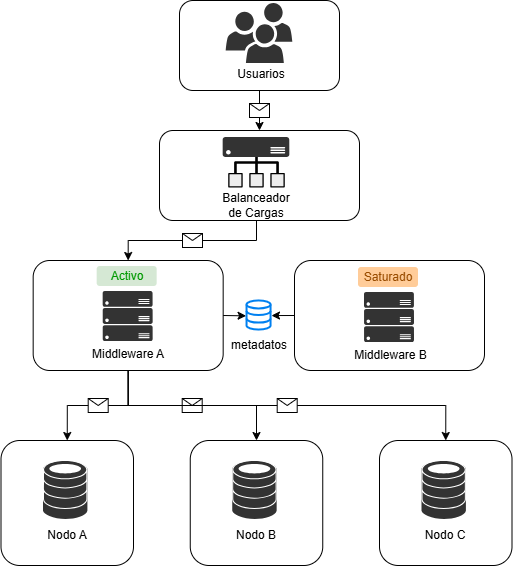
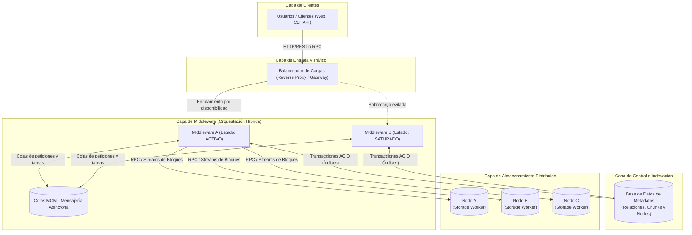
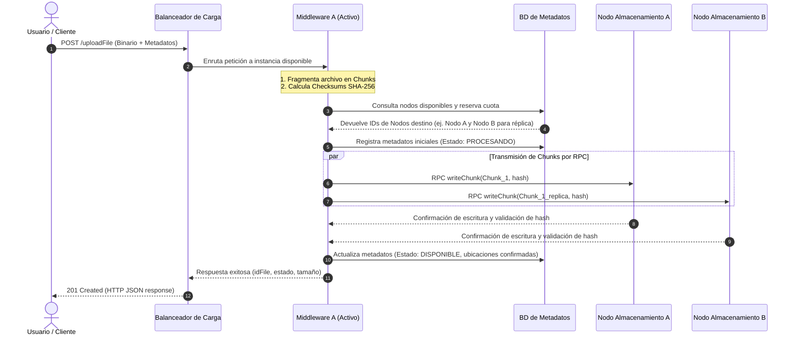
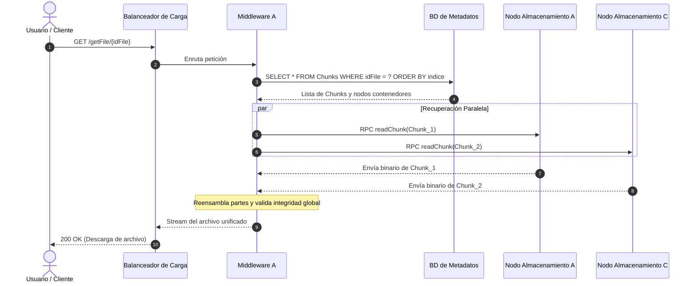
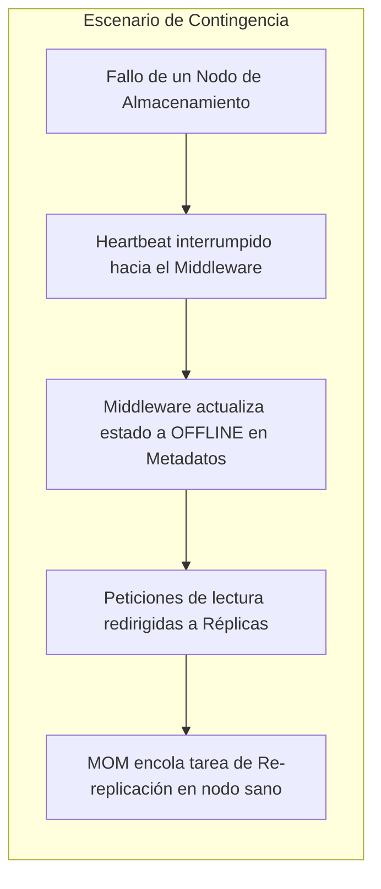

# Propuesta de Arquitectura: Sistema de Archivos Distribuido de Alta Disponibilidad (DFS-HA)

*Sebastian Quiceno Loaiza*

## 1. Resumen del Alcance y la Arquitectura

Para desarrollar el **Sistema de Archivos Distribuido de Alta Disponibilidad** (*Distributed File System - High Availability*), se va a priorizar una solucion con alta resistencia a problemas comunes (puntos únicos de fallo, cuellos de botella en ancho de banda y capacidad finita de disco), proporcionando un entorno resistente a cargas pesadas, escalable horizontalmente y transparente para el usuario final.

El sistema usa una **arquitectura híbrida de comunicaciones** combinando:

1. **RPC (*Remote Procedure Call*)**: Ideal para operaciones sincrónicas de baja latencia donde el cliente o los componentes internos demandan transferencias inmediatas de datos e interactividad en tiempo real.

2. **MOM con Colas (*Message-Oriented Middleware QUEUEs*)**: Ideal para el desacoplamiento de cargas pesadas, la persistencia de peticiones en colas seguras, la absorción de ráfagas de tráfico (*traffic throttling*) y la coordinación asíncrona entre nodos.

A través de la separación estricta entre la **capa de control/metadatos** y la **capa de almacenamiento físico de datos**, el sistema garantiza alta disponibilidad, tolerancia a fallos ante la desconexión imprevista de nodos y un balanceo de carga adaptativo que procura evitar que los servidores se saturen.

---

## 2. Objetivos del Sistema

### 2.1. Objetivo General
Diseñar e implementar una arquitectura de almacenamiento distribuido en la nube capaz de fragmentar, replicar y orquestar el ciclo de vida completo de archivos digitales mediante un esquema distribuido desacoplado, resiliente y de alto rendimiento.

### 2.2. Objetivos Específicos
- **Desacoplar el plano de control del plano de datos**: Mantener una base de datos de metadatos optimizada que indexe la ubicación física de los fragmentos sin cargar el tráfico de bytes binarios en la misma.
- **Implementar alta concurrencia y balanceo adaptativo**: Desviar tráfico de forma transparente lejos de nodos saturados hacia instancias saludables y con menor carga de trabajo.
- **Garantizar la transparencia de distribución**: Asegurar que el usuario interactúe con una interfaz abstracta y unificada, omitiendo la complejidad de fragmentación, distribución geográfica y redundancia.
- **Tolerancia a fallos y resiliencia**: Evitar pérdidas de información mediante técnicas de particionamiento y replicación de bloques en múltiples nodos de almacenamiento independientes.

---

## 3. Topología de la Arquitectura

Este sistema se va a componer de:
- [Usuarios](#usuarios)
- [Balanceador de cargas](#balanceador-de-cargas)
- [Middlewares](#middleware)
- [Nodos (servidores)](#nodos)

### 3.1. Vista Lógica y Canales de Comunicación

## 4. Desglose de Componentes y Responsabilidades

### 4.1. Capa de Usuarios / Clientes (Frontend, SDK y CLI)
Es el punto con el cual el usuario final va a utilizar el sistema. Expone una interfaz simple e intuitiva de operaciones sobre archivos lógicos, encargándose únicamente de la autenticación del usuario y del envío estandarizado de comandos.

- **Aislamiento estructural**: No tiene visibilidad ni acceso directo a la base de datos de metadatos, a las colas internas ni a los discos de los nodos de almacenamiento.

- **Catálogo de operaciones expuestas**:
  - `uploadFile(file, options)`: Solicita la ingesta y almacenamiento de un archivo (petición `POST`).
  - `seeMetadata(idFile)`: Consulta atributos, estado de replicación, tamaño y firmas de verificación (petición `GET`).
  - `getFile(idFile)`: Solicita la recuperación y descarga unificada del archivo (petición `GET`).
  - `updateFile(idFile, newFile)`: Reemplaza o versiona el contenido de un archivo existente (petición `PUT`).
  - `deleteFile(idFile)`: Ejecuta la baja lógica y la orden de limpieza física de bloques (petición `DELETE`).

### 4.2. Capa de Balanceo de Carga (Load Balancer & API Gateway)
hace de intermediario para el **punto de acceso unificado** de hacia la red **BackEnd**. Sus funciones centrales son:
- **Detección de estado (*Health Checks*)**: Monitorea de manera continua la latencia, el uso de memoria/CPU y la tasa de consumo de peticiones en cada instancia de Middleware.
- **Enrutamiento inteligente por saturación**: En el diagrama de referencia, el balanceador detecta que el **Middleware B** está en condición de **Saturado** (cola llena o alta concurrencia de I/O) y direcciona selectivamente el flujo hacia el **Middleware A** (**Activo** y con recursos disponibles).
- **Protección perimetral**: Implementa terminación SSL/TLS, limitación de tasa (*Rate Limiting*) y validación temprana de tokens de sesión (JWT) para mitigar accesos no autorizados antes de impactar el núcleo del sistema.

### 4.3. Capa de Coordinación: Middlewares (MOM + RPC)
Representa el cerebro del sistema distribuido. Funciona como un clúster de nodos de cómputo sin estado (*stateless*), lo que permite escalar horizontalmente agregando más instancias conforme aumente la demanda.

- **Rol de Orquestador**:
  1. Recibe la petición asignada por el balanceador.
  2. Ejecuta el algoritmo de particionamiento (*chunking*) para dividir archivos voluminosos en bloques lógicos uniformes (por ejemplo, de 4 MB a 64 MB).
  3. Genera firmas hash criptográficas (SHA-256) por cada fragmento para asegurar la integridad de extremo a extremo.
  4. Consulta y actualiza la Base de Datos de Metadatos para registrar la topología del archivo.
  5. Despacha comandos de escritura/lectura hacia los Nodos de Almacenamiento.

- **Integración del Modelo Híbrido MOM + RPC**:
  | Mecanismo | Tecnología Conceptual | Ámbito de Aplicación en el DFS-HA | Justificación Técnica |
  | :--- | :--- | :--- | :--- |
  | **RPC** | gRPC / Protocol Buffers | Comunicación sincrónica punto a punto (Middleware $\leftrightarrow$ Nodos, Cliente $\leftrightarrow$ Gateway). | Máximo rendimiento en streaming binario, baja sobrecarga de serialización y llamadas fuertemente tipadas. |
  | **MOM** | Message Queues (RabbitMQ / Kafka) | Encolamiento de tareas pesadas, balanceo entre middlewares, replicación diferida y sincronización de eventos. | Desacopla emisores de receptores, absorbe picos de demanda y asegura entrega persistente (*guaranteed delivery*) ante caídas de nodos. |

### 4.4. Capa de Base de Datos de Metadatos
Es el registro central de estado que otorga coherencia lógica al sistema distribuido y del que se conecta el middleware.

- **Exclusión de binarios**: **No almacena el contenido de los archivos**, evitando problemas de fragmentación y cuellos de botella en la base de datos.

- **Información almacenada**:
  - **Entidad Archivo**: `idFile`, `nombreOriginal`, `tamañoTotal`, `formatoMime`, `hashGlobal`, `fechaCreacion`, `propietarioId`.
  - **Entidad Fragmento (*Chunk*)**: `idChunk`, `idFile`, `indiceSecuencia`, `tamañoBytes`, `checksumSha256`.
  - **Entidad Mapeo/Ubicación**: `idChunk`, `idNodo`, `rutaInterna`, `estadoReplica` (PRIMARIA, SECUNDARIA, EN_SINCRONIZACION).
  - **Directorio de Nodos**: `idNodo`, `direccionIp`, `puerto`, `estado` (ONLINE, DEGRADED, OFFLINE), `capacidadDisponible`.

### 4.5. Capa de Nodos de Almacenamiento (Storage Workers A, B y C)
Nodos dedicados exclusivamente a la persistencia en disco de los fragmentos binarios:
- **Aislamiento en red privada**: No son accesibles desde internet ni por los usuarios finales; únicamente aceptan conexiones autorizadas provenientes del clúster de middlewares.
- **Operaciones atómicas**: Ejecutan lecturas directas por bloque (`readChunk`), escrituras atómicas (`writeChunk`) y eliminaciones (`deleteChunk`).
- **Verificación local y Heartbeats**: Emplazan procesos demonio que envían latidos periódicos (*heartbeats*) con métricas de salud y ejecutan chequeos periódicos de integridad (*data scrubbing*) sobre los bloques almacenados.

---

## 5. Dinámica de Operaciones y Flujos de Datos

### 5.1. Flujo de Escritura y Carga (`uploadFile`)
Para almacenar un archivo garantizando alta disponibilidad y consistencia:

1. **Ingesta**: El cliente remite el archivo al Balanceador de Cargas.
2. **Asignación**: El balanceador inspecciona métricas de carga e identifica que **Middleware A** está activo y saludable.
3. **Chunking e Integridad**: Middleware A fracciona el flujo de datos en partes de tamaño homogéneo y calcula su hash identificador.
4. **Planificación de Distribución**: Consulta la base de datos de metadatos para obtener una lista ponderada de nodos con capacidad disponible y menor latencia.
5. **Persistencia Distribuida**: Empleando RPC streams, el middleware escribe concurrentemente cada fragmento y sus réplicas en distintos nodos (p. ej., Chunk 1 en Nodo A y copia de respaldo en Nodo B).
6. **Consolidación**: Tras validar los checksums devueltos por los nodos, el middleware confirma la transacción en la base de metadatos y notifica al cliente.

---

### 5.2. Flujo de Lectura y Recuperación (`getFile` y `seeMetadata`)

#### A. Consulta Rápida de Metadatos (`seeMetadata`)
- El cliente invoca la petición con el `idFile`.
- El balanceador enruta al middleware disponible.
- El middleware ejecuta una lectura rápida indexada sobre la base de datos de metadatos y retorna de inmediato la ficha técnica del archivo sin interactuar con los nodos de almacenamiento, optimizando ancho de banda y tiempos de respuesta.

#### B. Recuperación de Archivo Completo (`getFile`)

1. El usuario solicita la descarga del archivo mediante su identificador único.
2. El middleware consulta el catálogo de fragmentos en la base de datos de metadatos para conocer qué partes componen el archivo, su ordenamiento y en qué nodos residen.
3. El middleware solicita concurrentemente los fragmentos a los nodos correspondientes. En caso de que un nodo tarde en responder o falle, recurre de inmediato al nodo alternativo que almacena la réplica.
4. El middleware recompone los fragmentos en el orden secuencial correcto, valida la suma de comprobación total y envía el archivo al usuario mediante streaming continuo.

---

### 5.3. Flujo de Actualización (`updateFile`)
La actualización de archivos puede implementarse bajo dos estrategias según el caso de uso:
- **Versionado Inmutable**: Se escriben los nuevos fragmentos modificados con un nuevo identificador de versión, actualizando el puntero principal en la base de datos de metadatos únicamente cuando la escritura ha culminado con éxito. Este esquema previene condiciones de carrera (*race conditions*) y asegura lectura consistente sin bloqueos de archivo.
- **Reemplazo Atómico**: Se eliminan o sobreescriben los fragmentos obsoletos y se reajusta el mapa de bloques en la base de metadatos.

---

### 5.4. Flujo de Eliminación (`deleteFile`)
1. El cliente envía la solicitud de borrado para `idFile`.
2. El middleware marca el archivo en la base de datos de metadatos con el estado `ELIMINADO_LOGICO` (borrado suave o *soft delete*), impidiendo de inmediato que futuras lecturas lo encuentren.
3. Se publica un mensaje asíncrono en la cola **MOM** con los identificadores de fragmentos y nodos a depurar.
4. Los nodos de almacenamiento consumen el mensaje de la cola a su propio ritmo, liberan el espacio en disco físico y confirman la purga a la base de metadatos.

---

## 6. Resiliencia, Tolerancia a Fallos y Alta Disponibilidad

### 6.1. Gestión de Saturación de Middlewares
- **Síntoma**: Como se ilustra en el diagrama de la arquitectura, el **Middleware B** entra en estado **Saturado** debido a un alto volumen de operaciones de I/O o colas de espera elevadas.
- **Mitigación**: Los agentes de supervisión del Balanceador de Cargas detectan el incremento de latencia o consumo de recursos en B y modifican dinámicamente el peso en el algoritmo de distribución (por ejemplo, *Weighted Least Connections*), desviando el 100% de las nuevas peticiones hacia **Middleware A**.
- **MOM como Amortiguador**: Las solicitudes no urgentes se mantienen seguras en colas de mensajes, garantizando que ninguna orden se pierda por sobrecarga del procesador.

### 6.2. Tolerancia a Fallos en Nodos de Almacenamiento
- **Factor de Replicación ($R \ge 2$)**: Cada fragmento de archivo se replica en al menos dos nodos físicamente independientes (por ejemplo, Chunk 1 reside en Nodo A y Nodo B).
- **Caída de Nodo A**:
  1. Si el Nodo A queda inoperativo, las lecturas en curso se conmutan instantáneamente hacia la réplica alojada en el Nodo B sin interrupción para el cliente.
  2. El middleware publica un evento en el sistema MOM solicitando restablecer el nivel de redundancia.
  3. Un nodo disponible (ej. Nodo C) toma la réplica desde el Nodo B y reconstituye el factor de replicación requerido.

### 6.3. Integridad y Auto-sanación (*Self-healing*)
- Cada bloque tiene asociado un hash criptográfico inmutable. Si durante una lectura se detecta una discordancia en el hash (*bit rot* o corrupción de datos), el bloque es descartado de inmediato, se sirve la réplica íntegra al usuario y se regenera la copia dañada en segundo plano.

---

## 7. Transparencias del Sistema Distribuido

La arquitectura implementa de manera estricta los principios clásicos de transparencia en sistemas distribuidos:

| Dimensión de Transparencia | Implementación en la Arquitectura DFS-HA |
| :--- | :--- |
| **Transparencia de Ubicación** | El cliente accede a los archivos mediante identificadores universales abstractos (`idFile`), sin requerir conocimiento de las direcciones IP de los nodos ni de las rutas físicas de disco. |
| **Transparencia de Fragmentación** | La división del archivo en múltiples bloques se ejecuta en la capa de coordinación; el usuario percibe el archivo como una unidad indivisible y continua. |
| **Transparencia de Replicación** | El usuario desconoce la cantidad de copias existentes de sus fragmentos ni en qué nodos han sido distribuidas para salvaguardar la durabilidad. |
| **Transparencia de Concurrencia** | Múltiples clientes pueden consultar y escribir simultáneamente gracias al arbitraje de transacciones en la capa de metadatos y al uso de colas distribuidas. |
| **Transparencia de Fallos** | Si un nodo de almacenamiento o un middleware colapsa, el tráfico es reconducido automáticamente a instancias alternativas sin emitir mensajes de error al usuario final. |

---