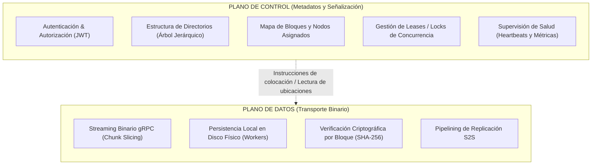
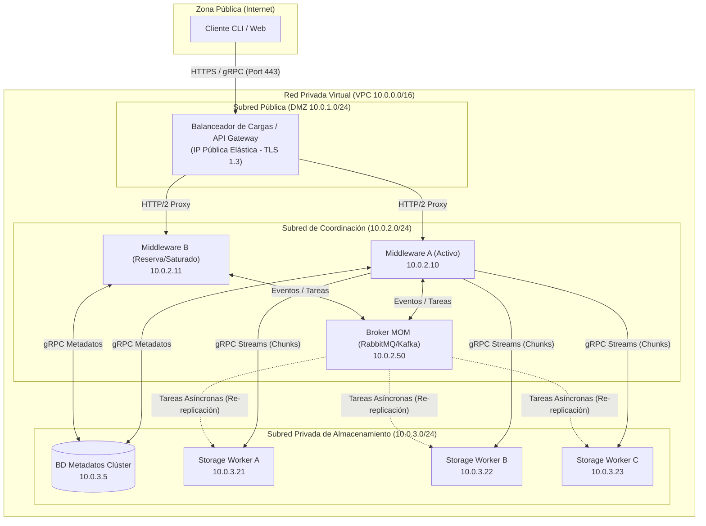
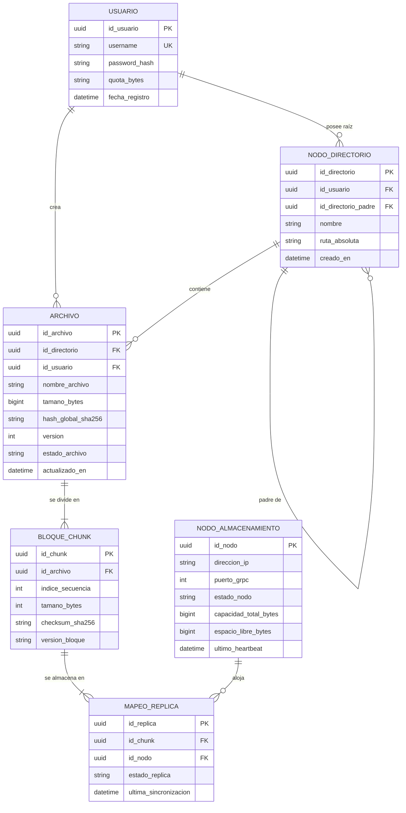
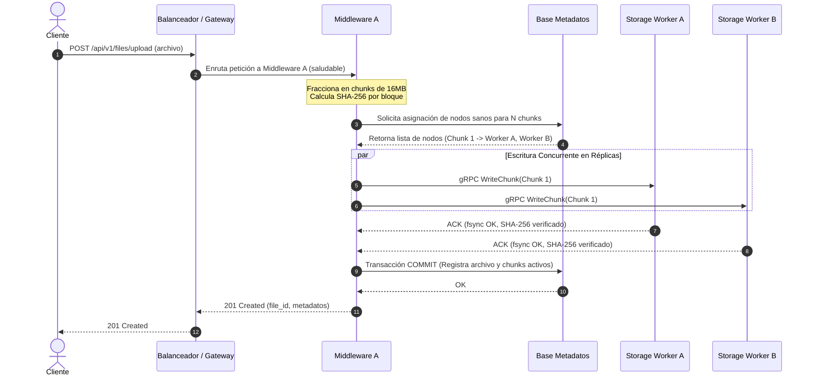
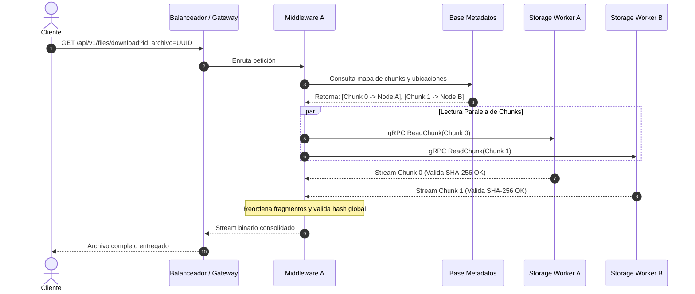
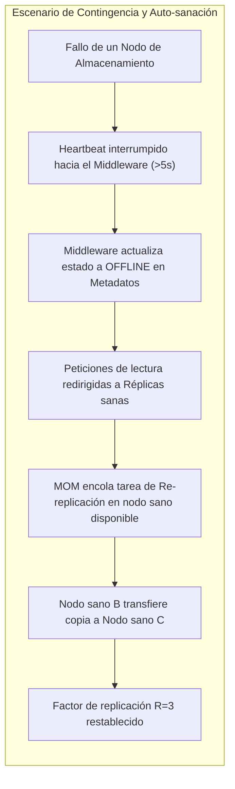

# Documento de Diseño Arquitectónico: Sistema de Archivos Distribuido de Alta Disponibilidad (DFSha)
**Sistemas Distribuidos | 2026-2**  
**Proyecto 1 · DFSha**  
**Fase I — Propuesta y Diseño Arquitectónico Individual (40 %)**

* **Autor:** Sebastian Quiceno Loaiza  
* **Opción Arquitectónica Asignada:** Opción 1 — Cliente/Servidor con servicio distribuido entre servidores (S2S), operado dentro de una red privada virtual  
* **Fecha:** Octubre de 2026  

---

## Tabla de Contenidos
1. [Objetivos del Sistema y Alcance](#1-objetivos-del-sistema-y-alcance)
   - [1.1. Objetivo General](#11-objetivo-general)
   - [1.2. Objetivos Específicos](#12-objetivos-específicos)
   - [1.3. Supuestos y Limitaciones de Diseño](#13-supuestos-y-limitaciones-de-diseño)
2. [Matriz de Cumplimiento de Requisitos](#2-matriz-de-cumplimiento-de-requisitos)
   - [2.1. Requisitos Funcionales (RF1 – RF3)](#21-requisitos-funcionales-rf1--rf3)
   - [2.2. Requisitos No Funcionales (RNF1 – RNF7)](#22-requisitos-no-funcionales-rnf1--rnf7)
3. [Topología y Arquitectura del Sistema (Opción 1: S2S)](#3-topología-y-arquitectura-del-sistema-opción-1-s2s)
   - [3.1. Visión General de la Arquitectura](#31-visión-general-de-la-arquitectura)
   - [3.2. Desacoplamiento de Planos: Control vs. Datos](#32-desacoplamiento-de-planos-control-vs-datos)
   - [3.3. Desglose de Componentes y Responsabilidades](#33-desglose-de-componentes-y-responsabilidades)
   - [3.4. Modelo Híbrido de Comunicaciones (RPC + MOM)](#34-modelo-híbrido-de-comunicaciones-rpc--mom)
   - [3.5. Diagrama de Despliegue e Infraestructura de Red](#35-diagrama-de-despliegue-e-infraestructura-de-red)
4. [Particionamiento, Bloques y Modelo de Metadatos](#4-particionamiento-bloques-y-modelo-de-metadatos)
   - [4.1. Algoritmo de Fraccionamiento (*Chunking*)](#41-algoritmo-de-fraccionamiento-chunking)
   - [4.2. Estructura y Esquema de Metadatos](#42-estructura-y-esquema-de-metadatos)
   - [4.3. Política de Asignación y Replicación ($R \ge 2$)](#43-política-de-asignación-y-replicación-r-ge-2)
   - [4.4. Localización y Reconstrucción de Archivos](#44-localización-y-reconstrucción-de-archivos)
5. [Especificación de Protocolos y APIs](#5-especificación-de-protocolos-y-apis)
   - [5.1. API Externa: Cliente $\leftrightarrow$ Gateway / Middleware](#51-api-externa-cliente-leftrightarrow-gateway--middleware)
   - [5.2. Protocolo Interno: Middleware $\leftrightarrow$ Nodos de Almacenamiento (gRPC)](#52-protocolo-interno-middleware-leftrightarrow-nodos-de-almacenamiento-grpc)
   - [5.3. Coordinación Asíncrona: Tareas en MOM](#53-coordinación-asíncrona-tareas-en-mom)
   - [5.4. Estándar de Errores y Códigos de Estado](#54-estándar-de-errores-y-códigos-de-estado)
6. [Semántica de Operaciones de E/S y Concurrencia](#6-semántica-de-operaciones-de-es-y-concurrencia)
   - [6.1. Semántica Declarada de `read()` y `write()`](#61-semántica-declarada-de-read-y-write)
   - [6.2. Exclusión Mutua y Control de Concurrencia](#62-exclusión-mutua-y-control-de-concurrencia)
   - [6.3. Garantía de Integridad (Checksumming)](#63-garantía-de-integridad-checksumming)
   - [6.4. Recuperación ante Escrituras Interrumpidas](#64-recuperación-ante-escrituras-interrumpidas)
7. [Dinámica de Operaciones y Flujos de Datos](#7-dinámica-de-operaciones-y-flujos-de-datos)
   - [7.1. Flujo de Escritura y Carga (`put` / `uploadFile`)](#71-flujo-de-escritura-y-carga-put--uploadfile)
   - [7.2. Flujo de Lectura y Consulta (`get` y `seeMetadata`)](#72-flujo-de-lectura-y-consulta-get-y-seemetadata)
   - [7.3. Flujo de Actualización y Modificación (`updateFile`)](#73-flujo-de-actualización-y-modificación-updatefile)
   - [7.4. Flujo de Eliminación (`deleteFile` / `rm`)](#74-flujo-de-eliminación-deletefile--rm)
8. [Resiliencia, Tolerancia a Fallos y Alta Disponibilidad](#8-resiliencia-tolerancia-a-fallos-y-alta-disponibilidad)
   - [8.1. Detección de Caídas Mediante Heartbeats](#81-detección-de-caídas-mediante-heartbeats)
   - [8.2. Gestión de Sobrecarga y Saturación de Middlewares](#82-gestión-de-sobrecarga-y-saturación-de-middlewares)
   - [8.3. Auto-sanación (*Self-healing*) y Re-replicación](#83-auto-sanación-self-healing-y-re-replicación)
9. [Seguridad y Aislamiento](#9-seguridad-y-aislamiento)
   - [9.1. Autenticación y Autorización por Usuario](#91-autenticación-y-autorización-por-usuario)
   - [9.2. Cifrado en Tránsito y Reposo](#92-cifrado-en-tránsito-y-reposo)
   - [9.3. Protección del Tráfico Interno S2S](#93-protección-del-tráfico-interno-s2s)
10. [Transparencias del Sistema Distribuido](#10-transparencias-del-sistema-distribuido)
11. [Escenarios Obligatorios de Razonamiento](#11-escenarios-obligatorios-de-razonamiento)
    - [11.1. Escenario 1: Escritura Concurrente sobre el Mismo Bloque](#111-escenario-1-escritura-concurrente-sobre-el-mismo-bloque)
    - [11.2. Escenario 2: Réplica Desconectada durante la Escritura](#112-escenario-2-réplica-desconectada-durante-la-escritura)
    - [11.3. Escenario 3: Caída de un Nodo con Bloque Parcial](#113-escenario-3-caída-de-un-nodo-con-bloque-parcial)
    - [11.4. Escenario 4: Descubrimiento Dinámico de Bloques](#114-escenario-4-descubrimiento-dinámico-de-bloques)
12. [Plan de Pruebas, Métricas y Evaluación Experimental](#12-plan-de-pruebas-métricas-y-evaluación-experimental)
    - [12.1. Métricas Clave de Desempeño](#121-métricas-clave-de-desempeño)
    - [12.2. Batería de Experimentos Propuestos](#122-batería-de-experimentos-propuestos)
    - [12.3. Justificación de Compromisos Técnicos (CAP / PACELC)](#123-justificación-de-compromisos-técnicos-cap--pacelc)
13. [Referencias Técnicas y Bibliográficas](#13-referencias-técnicas-y-bibliográficas)

---

## 1. Objetivos del Sistema y Alcance

### 1.1. Objetivo General
Diseñar e implementar la arquitectura de un **Sistema de Archivos Distribuido de Alta Disponibilidad (*DFSha*)** que permita almacenar, acceder y orquestar el ciclo de vida de archivos digitales de gran tamaño a través de múltiples nodos cooperativos. El sistema integra mecanismos de particionamiento en bloques, replicación estocástica y determinista, tolerancia a fallos, consistencia de datos, alto rendimiento en lectura/escritura y transparencia integral, garantizando que el usuario interactúe con un único espacio lógico seguro sin conocimiento de la infraestructura física subyacente.

### 1.2. Objetivos Específicos
1. **Desacoplar el plano de control del plano de datos:** Separar radicalmente el manejo del catálogo jerárquico y metadatos de la transmisión de flujos binarios puros, previniendo cuellos de botella en la base de datos de control.
2. **Implementar particionamiento y replicación horizontal:** Fraccionar archivos de gran envergadura en bloques homogéneos (*chunks*) distribuidos entre nodos de almacenamiento independientes, garantizando un factor de replicación $R \ge 2$.
3. **Ofrecer comunicaciones híbridas optimizadas:** Emplear Remote Procedure Calls (**RPC / gRPC**) para la transferencia sincrónica de datos de alto ancho de banda y Middleware Orientado a Mensajes (**MOM con Colas**) para la absorción de ráfagas, sincronización asíncrona y re-replicación.
4. **Garantizar resiliencia y auto-sanación (*self-healing*):** Detectar de forma automática nodos caídos mediante *heartbeats* dinámicos y activar la restauración de réplicas huérfanas sin intervención de un operador humano.
5. **Asegurar la privacidad y seguridad perimetral:** Aislar estrictamente los espacios de almacenamiento por usuario, cifrar la información en reposo y en tránsito, y autenticar toda operación mediante tokens criptográficos.

### 1.3. Supuestos y Limitaciones de Diseño
* **Modelo Jerárquico por Usuario:** Cada usuario registrado posee una raíz de sistema de archivos privada (`/home/<username>/`). No se contempla el uso compartido de archivos entre diferentes cuentas ni enlaces duros (*hard links*) multiusuario.
* **Semántica de Archivo:** El sistema no busca conformidad completa con la especificación POSIX clásica; en su lugar, implementa una semántica adaptada a sistemas de archivos distribuidos a gran escala (similar a *Google File System* o *HDFS*), priorizando lecturas concurrentes rápidas, reemplazos atómicos y operaciones de adición (*append*), con escrituras concurrentes coordinadas mediante mecanismos de bloqueo por arrendamiento (*leases*).
* **Entorno de Red:** La solución opera bajo el esquema de **Opción 1: Cliente/Servidor con Servicio Distribuido entre Servidores (S2S)** desplegado en una nube privada virtual (VPC). Los nodos de almacenamiento carecen de direcciones IP públicas y solo responden a peticiones provenientes de los controladores autorizados.

---

## 2. Matriz de Cumplimiento de Requisitos

| Identificador | Clasificación | Requisito del Sistema | Estrategia de Solución Implementada en DFSha |
| :--- | :--- | :--- | :--- |
| **RF1** | Funcional | Gestión del sistema de archivos jerárquico (`ls`, `cd`, `mkdir`, `rmdir`, `rm`). Espacio propio por usuario. | Árbol lógico indexado en la base de datos de metadatos. Cada usuario autenticado opera sobre un espacio aislado `/<user_id>/...`. Validación estricta en Gateway/Middleware. |
| **RF2** | Funcional | Transferencia de archivos completos (`send`/`put`, `receive`/`get`). | Particionamiento en streaming binario vía gRPC. Ingesta por bloques, validación de integridad y ensamble transparente al recuperar. |
| **RF3** | Funcional | Primitivas de acceso y control (`open`, `close`, `read`, `write`, `lock`, `unlock`). | Implementación de descriptores de sesión lógica, control de leases distribuidos en metadatos y semántica declarada de escritura atómica y append. |
| **RNF1** | No Funcional | Escalabilidad en usuarios, cantidad y tamaño de archivos. | Middlewares sin estado (*stateless*), balanceador de carga elástico, particionamiento en bloques de tamaño fijo (4 MB a 64 MB) y metadatos relacionales/NoSQL optimizados. |
| **RNF2** | No Funcional | Alta disponibilidad y redundancia ante fallos. | Factor de replicación $R=3$ (mínimo $R=2$). Conmutación automática a réplicas sanas ante desconexiones. Monitoreo por *heartbeats*. |
| **RNF3** | No Funcional | Consistencia de datos y tratamiento de réplicas. | Modelo de consistencia fuerte para metadatos (quórum en transacciones) y consistencia monótona/eventual coordinada para bloques de datos mediante *two-phase commit* simplificado. |
| **RNF4** | No Funcional | Particionamiento de archivos entre múltiples nodos. | Algoritmo determinista de selección de nodos con conocimiento de carga (*load-aware placement*). Ningún archivo reside en un único disco. |
| **RNF5** | No Funcional | Rendimiento y concurrencia multi-nodo. | I/O en paralelo hacia múltiples trabajadores de almacenamiento; colas MOM (RabbitMQ/Kafka) para descompresión de picos de carga y streaming HTTP/2 binario. |
| **RNF6** | No Funcional | Seguridad de datos y comunicaciones. | Autenticación basada en JWT, cifrado en tránsito mediante TLS 1.3 (perímetro) y mTLS (interno S2S), cifrado en reposo con AES-256-GCM y RBAC. |
| **RNF7** | No Funcional | Transparencia de acceso y localización. | El cliente no conoce IPs ni puertos de almacenamiento. Toda dirección se resuelve dinámicamente mediante el orquestador de metadatos. |

---

## 3. Topología y Arquitectura del Sistema (Opción 1: S2S)

### 3.1. Visión General de la Arquitectura
El sistema adopta el modelo **Cliente/Servidor con servicio distribuido entre servidores (S2S)**. El clúster interno colabora a través de una red privada para balancear trabajo, replicar bloques y mantener la coherencia.


### 3.2. Desacoplamiento de Planos: Control vs. Datos
Para evitar que el nodo maestro o el catálogo colapse con el tráfico de archivos de gigabytes, se establece una división estricta:



### 3.3. Desglose de Componentes y Responsabilidades

#### A. Capa de Clientes (CLI, SDK y Frontend Web)
* **Función:** Interfaz expuesta al usuario. Captura comandos jerárquicos (`mkdir`, `ls`, `cd`) y transferencias (`put`, `get`).
* **Aislamiento:** No conoce la infraestructura física de nodos, IPs internas ni esquemas de bases de datos. Se comunica exclusivamente con el **API Gateway** mediante peticiones HTTPS/gRPC autenticadas.
* **Gestión de Sesión:** Mantiene el token de sesión y el descriptor del directorio de trabajo actual (`current_working_directory`).

#### B. Capa de Balanceo de Carga y API Gateway (Reverse Proxy)
* **Punto Único de Entrada:** Recibe el tráfico perimetral sobre puerto seguro 443 (TLS 1.3).
* **Inspección de Salud (*Health Checking*):** Mide la saturación de los Middlewares (latencia, uso de CPU, ocupación de colas). Si el **Middleware B** se satura, desvía el 100% de las nuevas peticiones hacia el **Middleware A** (*Weighted Least Connections*).
* **Seguridad Perimetral:** Valida firmas criptográficas de tokens JWT, filtra solicitudes maliciosas e impone políticas de limitación de tasa (*Rate Limiting*).

#### C. Capa de Coordinación: Clúster de Middlewares (Stateless Controllers)
* **Cerebro del DFSha:** Clúster elástico sin estado. Cualquier nodo middleware puede procesar cualquier petición consultando la base de metadatos.
* **Orquestación de Ingesta:** Fracciona los archivos entrantes en bloques (*chunking*), genera sus sumas de verificación (*checksums* SHA-256) y consulta la base de datos de metadatos para planificar la colocación en nodos con espacio disponible.
* **Coordinación de Lectura:** Obtiene la lista de bloques de un archivo, recupera los chunks concurrentemente desde los nodos de almacenamiento sanos, verifica su integridad y emite el flujo consolidado al cliente.

#### D. Capa de Base de Datos de Metadatos
* **Registro de Estado Global:** Base de datos relacional de alta velocidad o almacén clave-valor consistente (ej. PostgreSQL replicado o etcd).
* **Exclusión Absoluta de Binarios:** Solo registra esquemas lógicos, rutas de directorio, permisos, listas de chunks y mapeo a nodos de datos. Jamás guarda contenido binario.

#### E. Capa de Nodos de Almacenamiento (Storage Workers A, B y C)
* **Persistencia Física Pura:** Demonios de almacenamiento que residen en servidores Linux dentro de la subred privada.
* **Operaciones Atómicas:** Exponen una interfaz gRPC interna con primitivas de lectura (`readChunk`), escritura con fsync (`writeChunk`) y borrado (`deleteChunk`).
* ~~**Verificación de Fondo (*Data Scrubbing*):** Tareas periódicas que leen los bloques almacenados y recalculan los hashes SHA-256 para detectar fallos silenciosos de disco (*bit rot*).~~

### 3.4. Modelo Híbrido de Comunicaciones (RPC + MOM)

El sistema combina el paradigma de llamadas a procedimientos remotos con el paradigma de colas de mensajes asíncronas para explotar lo mejor de ambos mundos:

| Característica | Remote Procedure Call (RPC / gRPC) | Message-Oriented Middleware (MOM con Colas) |
| :--- | :--- | :--- |
| **Tecnología** | gRPC sobre HTTP/2 (Protocol Buffers) | RabbitMQ / Apache Kafka |
| **Naturaleza** | Sincrónico, bidireccional, bajo overhead | Asíncrono, persistente, desacoplado temporalmente |
| **Casos de Uso** | • Transferencia de bloques binarios (Middleware $\leftrightarrow$ Worker)<br>• Autenticación y resolución de metadatos en tiempo real<br>• Primitivas de streaming de descarga y subida | • Tareas pesadas de re-replicación tras caída de nodos<br>• Encolamiento de órdenes de purga física de bloques borrados<br>• Amortiguación de ráfagas masivas de solicitudes de escritura |
| **Ventaja Clave** | Serialización ultrarrápida y latencia mínima de I/O. | Resiliencia garantizada: si un nodo de destino está temporalmente inoperativo, el mensaje espera en cola sin pérdida de datos. |

### 3.5. Diagrama de Despliegue e Infraestructura de Red

El despliegue opera sobre una **Virtual Private Cloud (VPC)** dividida en zonas de seguridad:



---

## 4. Particionamiento, Bloques y Modelo de Metadatos

### 4.1. Algoritmo de Fraccionamiento (*Chunking*)
* **Tamaño Fijo de Bloque:** Se define un tamaño estándar de bloque de **$S = 16\text{ MB}$** (configurable entre 4 MB y 64 MB según el perfil de carga).
  * Los archivos menores o iguales a 16 MB ocupan un único bloque.
  * Un archivo de 100 MB se segmenta en $\lceil 100 / 16 \rceil = 7$ fragmentos: 6 bloques de 16 MB y 1 bloque final de 4 MB.
* **Identificación Criptográfica:** Cada bloque recibe un identificador global único universal (*UUIDv4*) y un hash SHA-256 calculado a partir de su contenido binario.

### 4.2. Estructura y Esquema de Metadatos

El catálogo de metadatos se organiza en un esquema relacional normalizado:



### 4.3. Política de Asignación y Replicación ($R \ge 2$)
* **Factor de Replicación:** Se fija un factor por defecto de **$R = 3$** (y un umbral mínimo tolerable de $R = 2$).
* **Heurística de Selección de Nodos (*Placement Engine*):**
  1. **Disponibilidad:** El nodo debe reportar estado `ONLINE` y haber emitido un heartbeat en los últimos 5 segundos.
  2. **Capacidad Relativa:** Se pondera la selección favoreciendo nodos con menor porcentaje de ocupación de disco.
  3. **Dispersión:** Dos réplicas del mismo bloque jamás pueden residir en el mismo nodo físico o en el mismo bastidor (*rack-awareness*).

### 4.4. Localización y Reconstrucción de Archivos
* **Localización Dinámica:** El cliente solicita abrir un archivo por su ruta lógica (ej. `/home/user1/docs/video.mp4`). El middleware traduce la ruta a `id_archivo`, recupera la lista ordenada de `id_chunk` con sus nodos asociados y determina la réplica más cercana o con menor latencia para cada bloque.
* **Reconstrucción:**
  $$Archivo = \bigcup_{i=0}^{N-1} Chunk_i \quad \text{donde } i \text{ es el índice de secuencia}$$
  El middleware solicita los chunks en paralelo. A medida que llegan los fragmentos, se comprueba su hash `SHA-256`. Si coincide, se transmiten en orden hacia el cliente.

---

## 5. Especificación de Protocolos y APIs

### 5.1. API Externa: Cliente $\leftrightarrow$ Gateway / Middleware

La capa exterior expone un conjunto balanceado de endpoints RESTful con payloads JSON para el plano de control y endpoints de transferencia de datos en streaming.

#### A. Gestión Jerárquica y Metadatos (RF1)

* **`POST /api/v1/fs/mkdir`** (Creación de Directorio)
  * *Headers:* `Authorization: Bearer <JWT>`
  * *Request Body:*
    ```json
    {
      "path": "/home/squiceno/proyectos",
      "create_parents": true
    }
    ```
  * *Response (201 Created):*
    ```json
    {
      "status": "success",
      "directory_id": "9b1deb4d-3b7d-4bad-9bdd-2b0d7b3dcb6d",
      "path": "/home/squiceno/proyectos",
      "created_at": "2026-10-23T09:30:00Z"
    }
    ```

* **`GET /api/v1/fs/ls?path=/home/squiceno`** (Listar Contenido de Directorio)
  * *Headers:* `Authorization: Bearer <JWT>`
  * *Response (200 OK):*
    ```json
    {
      "current_directory": "/home/squiceno",
      "entries": [
        {
          "name": "proyectos",
          "type": "DIRECTORY",
          "size_bytes": 0,
          "modified_at": "2026-10-23T09:30:00Z"
        },
        {
          "name": "datos_grandes.iso",
          "type": "FILE",
          "size_bytes": 1073741824,
          "file_id": "c4ca4238-a0b9-3382-8dcc-509a6f75849b",
          "checksum": "e3b0c44298fc1c149afbf4c8996fb92427ae41e4649b934ca495991b7852b855",
          "modified_at": "2026-10-23T08:15:20Z"
        }
      ]
    }
    ```

* **`DELETE /api/v1/fs/rm`** (Eliminar Archivo o Directorio)
  * *Request Body:*
    ```json
    {
      "path": "/home/squiceno/datos_grandes.iso",
      "recursive": false
    }
    ```
  * *Response (200 OK):*
    ```json
    {
      "status": "success",
      "message": "Entidad marcada para eliminación lógica y purga física en cola"
    }
    ```

#### B. Primitivas de Archivo y Transferencia (RF2 y RF3)

* **`POST /api/v1/files/upload` (`put` / `send`)**
  * *Headers:* `Authorization: Bearer <JWT>`, `Content-Type: multipart/form-data`
  * *Parámetros:* `path=/home/squiceno/archivo.bin`, `write_mode=CREATE_OR_REPLACE`
  * *Streaming de subida:* El Gateway pasa el stream directamente al Middleware activo.

* **`GET /api/v1/files/download` (`get` / `recv`)**
  * *Headers:* `Authorization: Bearer <JWT>`
  * *Query Params:* `path=/home/squiceno/archivo.bin` o `file_id=c4ca4238...`
  * *Streaming de descarga:* Retorna cabecera `Content-Type: application/octet-stream` y el binario ensamblado.

* **`POST /api/v1/files/lock` (`lock` / `unlock`)**
  * *Request Body:*
    ```json
    {
      "file_path": "/home/squiceno/archivo.bin",
      "lock_type": "EXCLUSIVE_WRITE",
      "lease_duration_ms": 30000
    }
    ```
  * *Response (200 OK):*
    ```json
    {
      "lock_token": "lease-token-88f1-39ac",
      "granted_at": "2026-10-23T09:35:10Z",
      "expires_at": "2026-10-23T09:35:40Z"
    }
    ```

### 5.2. Protocolo Interno: Middleware $\leftrightarrow$ Nodos de Almacenamiento (gRPC)

La comunicación interna utiliza **gRPC** sobre **Protocol Buffers** para garantizar el máximo rendimiento:

```protobuf
syntax = "proto3";

package dfsha.storage;

service StorageWorkerService {
  // Transferencia de un bloque en streaming continuo
  rpc WriteChunk(stream WriteChunkRequest) returns (WriteChunkResponse);
  
  // Lectura de un bloque por streaming
  rpc ReadChunk(ReadChunkRequest) returns (stream ReadChunkResponse);
  
  // Eliminación física de un bloque
  rpc DeleteChunk(DeleteChunkRequest) returns (DeleteChunkResponse);
  
  // Verificación de integridad local
  rpc VerifyChunkIntegrity(VerifyChunkRequest) returns (VerifyChunkResponse);
  
  // Latido de salud emitido periódicamente hacia el coordinador
  rpc SendHeartbeat(HeartbeatRequest) returns (HeartbeatResponse);
}

message WriteChunkRequest {
  oneof payload {
    ChunkMetadata metadata = 1;
    bytes chunk_data = 2;
  }
}

message ChunkMetadata {
  string chunk_id = 1;
  string file_id = 2;
  int64 chunk_size_bytes = 3;
  string expected_sha256 = 4;
}

message WriteChunkResponse {
  string chunk_id = 1;
  bool success = 2;
  string actual_sha256 = 3;
  string error_message = 4;
}

message ReadChunkRequest {
  string chunk_id = 1;
  int64 offset_bytes = 2;
  int64 length_bytes = 3;
}

message ReadChunkResponse {
  bytes data_chunk = 1;
  string chunk_id = 2;
}

message DeleteChunkRequest {
  string chunk_id = 1;
}

message DeleteChunkResponse {
  bool success = 1;
}
```

### 5.3. Coordinación Asíncrona: Tareas en MOM

Para procesos no interactivos, el clúster utiliza un Message-Oriented Middleware con tópicos definidos:

1. **`dfsha.tasks.re-replication`**: Publicado cuando un nodo cae y un bloque queda con réplicas insuficientes ($R < 3$).
   ```json
   {
     "task_id": "rep-9912",
     "chunk_id": "chunk-101",
     "source_node_ip": "10.0.3.22",
     "target_node_ip": "10.0.3.23",
     "expected_sha256": "4a5e1e...c9"
   }
   ```
2. **`dfsha.tasks.purge`**: Encola la destrucción definitiva de chunks huérfanos tras operaciones `rm` o fallos en staging.

### 5.4. Estándar de Errores y Códigos de Estado

Todas las respuestas de fallo siguen el estándar de especificación de problemas **RFC 7807**:

```json
{
  "type": "https://dfsha.local/errors/lock-conflict",
  "title": "Archivo bloqueado por otro proceso",
  "status": 409,
  "detail": "El archivo /home/user1/data.csv posee un bloqueo de escritura activo (Lease ID: lease-token-88f1) que expira en 14 segundos.",
  "instance": "/api/v1/files/lock",
  "error_code": "ERR_EXCLUSIVE_LOCK_ACTIVE"
}
```

Códigos representativos del sistema:
* `401 Unauthorized`: Token JWT expirado o inválido.
* `403 Forbidden`: Intento de acceder a un directorio o archivo ajeno a su espacio de usuario.
* `404 Not Found`: Ruta o identificador de archivo inexistente.
* `409 Conflict`: Conflicto de bloqueo exclusivo o colisión de nombre sin flag de sobrescritura.
* `503 Service Unavailable`: Réplicas insuficientes disponibles para satisfacer el quórum de escritura.

---

## 6. Semántica de Operaciones de E/S y Concurrencia

### 6.1. Semántica Declarada de `read()` y `write()`

Para disipar ambigüedades técnicas, el equipo adopta formalmente la siguiente semántica:

1. **Granularidad de Operación:**
   * La unidad mínima de persistencia, direccionamiento y verificación criptográfica es el **bloque (*chunk*)**.
2. **Operaciones Admitidas:**
   * **Creación:** Se admiten nuevos archivos asignando chunks nuevos secuenciales.
   * **Reemplazo Total (*Overwriting via Copy-On-Write*):** No se sobrescriben bloques in-situ de forma destructiva. Se escriben los nuevos chunks asociados a una nueva versión lógica del archivo; el puntero en la base de metadatos conmuta atómicamente cuando todos los bloques alcanzan quórum.
   * **Anexado (*Atomic Append*):** Se permite adjuntar datos al final del archivo (`append`). Si el último bloque tiene capacidad remanente, se anexa; en caso contrario, se reserva un nuevo bloque en el catálogo. Múltiples appends concurrentes se encolan serialmente a través del lease del archivo.
   * **Modificación Parcial por Bloque:** Admitida mediante lectura-modificación-escritura (*Read-Modify-Write*) del bloque específico bajo un bloqueo exclusivo temporal.
3. **Visibilidad de Escrituras:**
   * **Compromiso por Quórum (*Quorum-Commit*):** Una escritura solo se hace visible para futuros `read()` una vez que la confirmación de persistencia física en disco (`fsync`) es alcanzada en al menos $\lfloor R/2 \rfloor + 1$ réplicas (por ejemplo, en 2 de 3 nodos) y los metadatos han sido actualizados atómicamente.

### 6.2. Exclusión Mutua y Control de Concurrencia
* **Modelo Lectores-Escritores (*Shared Readers / Exclusive Writer*):**
  * Múltiples clientes pueden ejecutar `read()` simultáneamente sobre el mismo archivo o bloque sin interferencia alguna.
  * Solo un cliente a la vez puede ostentar un `lock()` de escritura sobre un archivo o bloque.
* **Leases Distribuidos con Expiración Temporal:**
  * Los bloqueos no son infinitos; se conceden en la base de metadatos como arrendamientos temporales (*leases* de 30 segundos) renovables mediante *heartbeat* del cliente.
  * Si el cliente que escribe colapsa, el *lease* expira de forma automática, liberando el recurso y previniendo interbloqueos (*deadlocks*).

### 6.3. Garantía de Integridad (Checksumming)
* Cada bloque almacena su suma de verificación criptográfica **SHA-256**.
* Al leer un bloque, el nodo de almacenamiento o el middleware recalcula el hash. Si no coincide con el registrado en los metadatos:
  1. Se emite una alerta interna de corrupción (*bit rot*).
  2. El bloque corrupto es inmediatamente ignorado.
  3. Se solicita la réplica a un nodo alternativo sano para entregar el dato al cliente.
  4. Se programa de inmediato una tarea de auto-sanación en el MOM para regenerar la réplica dañada.

### 6.4. Recuperación ante Escrituras Interrumpidas
* **Staging y Dos Fases (*Two-Phase Commit Ligero*):**
  1. Los fragmentos se escriben en los nodos de almacenamiento en un estado preliminar `EN_STAGING`.
  2. Si el proceso de subida se corta a la mitad, los bloques en `EN_STAGING` nunca se indexan en el catálogo del archivo.
  3. Un recolector de basura asíncrono (*Garbage Collector*) barre periódicamente la base de datos y la cola MOM para eliminar los bloques huérfanos que excedan el tiempo límite de subida (ej. 10 minutos).

---

## 7. Dinámica de Operaciones y Flujos de Datos

### 7.1. Flujo de Escritura y Carga (`put` / `uploadFile`)

Asegura la fragmentación ordenada, cálculo de hashes y replicación balanceada:




---

### 7.2. Flujo de Lectura y Consulta (`get` y `seeMetadata`)

#### A. Consulta Rápida de Metadatos (`seeMetadata` / `ls`)
Permite conocer atributos, tamaño y verificación sin tocar los discos de datos:


* El cliente invoca la petición con el `id_archivo` o ruta de directorio.
* El balanceador enruta al middleware disponible.
* El middleware ejecuta una lectura rápida indexada sobre la base de datos de metadatos y retorna de inmediato la ficha técnica del archivo sin interactuar con los nodos de almacenamiento, optimizando ancho de banda y tiempos de respuesta.

#### B. Recuperación de Archivo Completo (`getFile` / `get`)
Ensambla y transmite el archivo combinando la lectura paralela de réplicas saludables:




---

### 7.3. Flujo de Actualización y Modificación (`updateFile`)

La modificación de archivos se ejecuta mediante **Copy-On-Write / Versionado Inmutable**:


1. El cliente adquiere un lease de escritura sobre el archivo.
2. Los bloques modificados se persisten como nuevas entidades de chunk con un nuevo identificador de versión (`version = V + 1`).
3. Los bloques no alterados conservan su referencia en el catálogo.
4. El middleware ejecuta un cambio atómico en los metadatos para apuntar a la nueva versión.
5. Los bloques de versiones antiguas no referenciados se encolan en el MOM para su posterior recolección de basura.

---

### 7.4. Flujo de Eliminación (`deleteFile` / `rm`)

Garantiza la eliminación inmediata para el usuario y la liberación ordenada de disco físico:


1. El cliente envía la solicitud de borrado para `path` o `file_id`.
2. El middleware marca el archivo en la base de metadatos con el estado `ELIMINADO_LOGICO` (*soft delete*). Desde ese instante exacto, cualquier intento subsiguiente de lectura o listado reporta `404 Not Found`.
3. Se publica un mensaje asíncrono en la cola MOM (`dfsha.tasks.purge`) con los identificadores de fragmentos y nodos a depurar.
4. Los trabajadores de almacenamiento consumen el mensaje a su propio ritmo, liberan el espacio en disco físico y confirman la purga a la base de metadatos.

---

## 8. Resiliencia, Tolerancia a Fallos y Alta Disponibilidad



### 8.1. Detección de Caídas Mediante Heartbeats
* Todos los nodos de almacenamiento emiten un pulso gRPC `SendHeartbeat` cada **2 segundos** hacia el clúster de middlewares.
* El pulso contiene: porcentaje de uso de CPU, I/O en disco, espacio libre y lista de chunks locales.
* Si transcurren **5 segundos** sin recibir el heartbeat de un nodo, el orquestador lo marca automáticamente como `OFFLINE` o `DEGRADED`.

### 8.2. Gestión de Sobrecarga y Saturación de Middlewares
* **Detección Activa:** El Balanceador de Carga monitorea métricas en tiempo real.
* **Mitigación Dinámica:** Si el **Middleware B** supera el umbral de saturación (por ejemplo, cola de solicitudes en espera > 100 o utilización de CPU > 85%), el balanceador altera los pesos de enrutamiento y conmuta el 100% de nuevas transferencias hacia el **Middleware A**.
* **Amortiguador MOM:** Peticiones asíncronas de mantenimiento o réplicas se almacenan de forma segura en colas persistentes sin sobrecargar los procesadores del sistema.

### 8.3. Auto-sanación (*Self-healing*) y Re-replicación
* **Detección de Sub-replicación:** Tras marcarse un nodo como caído, el orquestador identifica qué bloques han quedado con menos réplicas que el factor objetivo ($R < 3$).
* **Plan de Copia en Segundo Plano:** El orquestador inyecta una orden en el MOM. Un nodo saludable que posea una réplica válida (por ejemplo, Worker B) inicia una transmisión directa S2S hacia otro nodo disponible (Worker C) para recrear la réplica faltante.
* **Cero Impacto al Usuario:** Todo el proceso ocurre en segundo plano sin degradar la experiencia ni bloquear las lecturas activas.

---

## 9. Seguridad y Aislamiento

### 9.1. Autenticación y Autorización por Usuario
* **Identidad Federada / JWT:** Al iniciar sesión en el cliente, se emite un JSON Web Token firmado con clave asimétrica RSA-256 o Ed25519.
* **Aislamiento Estricto de Espacio Lógico:**
  * Toda ruta relativa ingresada por el usuario es resuelta forzosamente con el prefijo canónico `/home/<id_usuario>/`.
  * Ninguna operación (`ls`, `cd`, `read`, `write`, `rm`) puede traspasar las fronteras del árbol del usuario (*chroot lógico*).
  * Los intentos de atravesar rutas mediante secuencias `../` son interceptados y bloqueados en el API Gateway.

### 9.2. Cifrado en Tránsito y Reposo
* **En Tránsito:**
  * Todo enlace exterior (Cliente $\leftrightarrow$ API Gateway) está protegido con **TLS 1.3** con suites de cifrado modernas (ECDHE-RSA-AES128-GCM-SHA256).
  * Las transferencias internas entre Middlewares y Nodos de Almacenamiento utilizan **mTLS (Mutual TLS)** con certificados de corta duración emitidos por una Autoridad Certificadora (CA) interna.
* **En Reposo:**
  * Cada bloque persistido en el sistema de archivos del nodo de almacenamiento se cifra mediante **AES-256-GCM**.
  * El vector de inicialización (IV) y la etiqueta de autenticación (Tag) se resguardan junto con el fragmento, impidiendo que lecturas no autorizadas del disco físico expongan datos legibles.

### 9.3. Protección del Tráfico Interno S2S
* Los nodos de almacenamiento carecen de interfaces de red con salida pública.
* Reglas de firewall a nivel de red virtual (Security Groups) restringen el tráfico entrante al puerto gRPC únicamente a las IPs privadas autorizadas del clúster de middlewares.

---

## 10. Transparencias del Sistema Distribuido

La arquitectura implementa de manera estricta los principios clásicos de transparencia de sistemas distribuidos:

| Dimensión de Transparencia | Implementación en la Arquitectura DFSha |
| :--- | :--- |
| **Transparencia de Acceso** | El cliente opera con comandos estándar idénticos (`ls`, `cd`, `put`, `get`, `open`, `read`, `write`) independientemente de si los bloques se procesan localmente o se ensamblan desde múltiples servidores remotos. |
| **Transparencia de Ubicación** | El usuario accede a los archivos mediante identificadores universales abstractos o rutas lógicas (`/home/user/doc.pdf`). No necesita conocer direcciones IP, nombres de servidor ni rutas de montaje físico. |
| **Transparencia de Fragmentación** | La división del archivo en múltiples bloques homogéneos (*chunks*) y el cálculo de hashes se ejecuta en la capa intermedia; el usuario percibe el archivo como un flujo continuo indivisible. |
| **Transparencia de Replicación** | El usuario desconoce cuántas copias de respaldo existen de sus bloques ni en qué nodos de almacenamiento físicos residen para salvaguardar la durabilidad. |
| **Transparencia de Concurrencia** | Múltiples clientes pueden consultar y escribir simultáneamente sin percibir inconsistencias, gracias a la sincronización de leases en metadatos y al versionado inmutable (*Copy-On-Write*). |
| **Transparencia de Fallos** | Si un nodo de almacenamiento o un middleware colapsa, el tráfico es redirigido en milisegundos hacia réplicas sanas o controladores activos sin arrojar errores al usuario final. |
| **Transparencia de Escalabilidad** | Se pueden añadir dinámicamente nuevos trabajadores de almacenamiento o middlewares al clúster sin necesidad de reiniciar el servicio ni modificar la configuración del cliente. |

---

## 11. Escenarios Obligatorios de Razonamiento

### 11.1. Escenario 1: Escritura Concurrente sobre el Mismo Bloque
> **Pregunta:** *Dos procesos intentan escribir el mismo bloque de un archivo simultáneamente: ¿qué sucede y por qué?*

* **Resolución en DFSha:**
  1. En nuestra arquitectura, cualquier operación de modificación sobre un bloque existente requiere la concesión de un **arrendamiento de exclusión mutua (*Lease / Write Lock*)** registrado en la base de datos de metadatos.
  2. Cuando el **Proceso 1** y el **Proceso 2** solicitan escribir concurrentemente el bloque $B_k$, ambas solicitudes llegan al clúster de middlewares y compiten atómicamente por el *lock*.
  3. La base de datos de metadatos procesa una transacción serializable: el **Proceso 1** obtiene el *lock* exclusivo para el bloque y recibe un token de arrendamiento temporal con expiración.
  4. La solicitud del **Proceso 2** es interceptada por el middleware, retornando de inmediato un código de conflicto `409 Conflict` (o manteniéndola en espera activa si se solicitó con parámetro de espera diferida en la cola MOM).
  5. Adicionalmente, gracias a la estrategia de **Copy-On-Write (COW)**, el Proceso 1 no destruye el contenido original in-situ, sino que genera una nueva versión del bloque con los cambios aplicados. Solo cuando las réplicas confirman la escritura con éxito, se actualiza el puntero de versión en los metadatos.
  6. **Resultado:** Se previene de forma absoluta la intercalación destructiva de bytes (*corrupted interleaving*) y se asegura consistencia serializable.

---

### 11.2. Escenario 2: Réplica Desconectada durante la Escritura
> **Pregunta:** *Una réplica está desconectada durante una escritura: ¿qué observan los lectores y cómo se recupera?*

* **Resolución en DFSha:**
  1. **Comportamiento durante la Escritura:** Con un factor de replicación objetivo $R=3$, el sistema requiere un **quórum de escritura estricto** de $W = \lfloor R/2 \rfloor + 1 = 2$ réplicas. Si el Nodo A y el Nodo B están activos pero el Nodo C está desconectado, el middleware escribe concurrentemente en A y B. Al recibir las confirmaciones de A y B, el quórum se cumple satisfactoriamente y la escritura se consolida como exitosa en los metadatos.
  2. **Qué Observan los Lectores:**
     * Cualquier lector que consulte el archivo a través del middleware será enrutado exclusivamente a los nodos que poseen la versión actualizada (Nodo A o Nodo B).
     * Dado que el catálogo de metadatos marca la réplica del Nodo C con el estado `DESACTUALIZADA` o `OFFLINE`, ningún lector será dirigido a dicho nodo. Por tanto, los lectores observan en todo momento una **visión monótona y consistente** de los datos.
  3. **Cómo se Recupera:**
     * Cuando el Nodo C vuelve a conectarse y emite su latido (*heartbeat*), el orquestador compara el número de versión local de sus bloques con el catálogo central.
     * Al detectar que el bloque en C tiene una versión obsoleta, el middleware publica una orden de sincronización en el MOM.
     * El Nodo C solicita la copia actualizada desde el Nodo A o B, valida el checksum SHA-256, actualiza su disco local y notifica a los metadatos para pasar su estado a `SINCRONIZADA`.

---

### 11.3. Escenario 3: Caída de un Nodo con Bloque Parcial
> **Pregunta:** *Un nodo falla después de recibir parte de un bloque: ¿cómo se evita publicar un archivo incompleto?*

* **Resolución en DFSha:**
  1. **Aislamiento en Espacio de Trabajo Temporal (*Staging Buffer*):** Los nodos de almacenamiento jamás escriben directamente sobre el archivo final visible. Los bytes recibidos por streaming gRPC se escriben en un archivo temporal con extensión `.part` o en un directorio de *staging* asignado a la transacción.
  2. **Validación Criptográfica Estricta:** El nodo solo renombra el archivo temporal a su identificador definitivo tras recibir la señal de fin de stream (`EOF`) y constatar que el tamaño en bytes coincide con el esperado y que el hash SHA-256 recalculado es idéntico al emitido en los metadatos.
  3. **Confirmación en Dos Fases Simplificada:**
     * Si el nodo colapsa mientras transfería el 40% del bloque, la conexión gRPC se interrumpe abruptamente.
     * El middleware detecta el fallo por timeout en el socket y aborta la transacción para dicho nodo.
     * Al no alcanzarse el quórum de confirmaciones, el middleware **no registra el nuevo bloque en la base de metadatos**.
     * Para cualquier cliente o lector del sistema, el archivo incompleto sencillamente **no existe**, preservando la propiedad de atomicidad (*todo o nada*).
  4. **Purga de Residuos:** Al reiniciarse el nodo caído, su proceso demonio ejecuta una rutina de limpieza inicial que elimina cualquier archivo parcial huérfano (`*.part`) con una antigüedad superior a 15 minutos.

---

### 11.4. Escenario 4: Descubrimiento Dinámico de Bloques
> **Pregunta:** *El cliente desconoce la ubicación física de los bloques: ¿cómo los descubre dinámicamente?*

* **Resolución en DFSha:**
  1. **Desacoplamiento Absoluto:** El cliente no almacena tablas de enrutamiento estáticas ni IPs cableadas (*hardcoded*) de los nodos de almacenamiento; solo conoce la URL o dirección virtual del **API Gateway / Balanceador de Cargas**.
  2. **Protocolo de Resolución Dinámica:**
     * El cliente invoca la operación indicando únicamente la ruta lógica (ej. `GET /api/v1/files/download?path=/home/squiceno/reporte.pdf`).
     * El Gateway enruta la petición al middleware disponible.
     * El middleware consulta el catálogo de metadatos, el cual resuelve la jerarquía:
       $$\text{Ruta Lógica} \longrightarrow \text{ID Archivo} \longrightarrow [\text{Chunk}_0, \text{Chunk}_1, \dots, \text{Chunk}_n] \longrightarrow [\text{Nodos con réplica activa}]$$
  3. **Entrega Transparente Mediante Proxy:**
     * En nuestro diseño, el middleware actúa como orquestador transparente: es él quien contacta a los nodos de almacenamiento en la red privada, obtiene los fragmentos, verifica su integridad y transmite el flujo ya ensamblado al cliente en un único stream HTTP/2 o gRPC.
     * El cliente recibe el archivo completo de forma inmediata sin haberse comunicado jamás directamente con ninguno de los servidores de almacenamiento físicos.
  4. **Ventaja:** Permite mover bloques entre nodos, retirar servidores por mantenimiento o rebalancear discos sin requerir ninguna actualización en las aplicaciones cliente.

---

## 12. Plan de Pruebas, Métricas y Evaluación Experimental

### 12.1. Métricas Clave de Desempeño
Para validar empíricamente la arquitectura en la Fase II, se instrumentarán las siguientes métricas:

| Métrica | Descripción | Unidad de Medida | Herramienta de Medición |
| :--- | :--- | :--- | :--- |
| **Throughput de Escritura** | Tasa sostenida de ingesta de datos en el sistema. | MB/s | Medición en Gateway y Nodos de Datos |
| **Throughput de Lectura** | Velocidad de recuperación y ensamble de archivos. | MB/s | Medición en Cliente y Middleware |
| **Latencia de Operaciones de Control** | Tiempo de respuesta para comandos jerárquicos (`ls`, `mkdir`, `cd`). | Milisegundos ($p50, p95, p99$) | Prometheus + Grafana |
| **Tiempo de Recuperación ante Fallos (MTTR)** | Tiempo transcurrido entre la caída de un nodo y la restauración del factor de replicación $R=3$. | Segundos | Logs de eventos MOM y Metadatos |
| **Sobrecarga de Red por Replicación** | Volumen de bytes duplicados en la red interna para mantener redundancia. | Ratio de amplificación de red | Métricas de interfaz Linux (`ifconfig`/`nload`) |

### 12.2. Batería de Experimentos Propuestos
1. **Prueba de Escalabilidad de Tamaño de Archivo:**
   * Evaluar el comportamiento del sistema almacenando archivos de **10 MB, 100 MB, 1 GB y 5 GB**.
   * *Objetivo:* Comprobar que el uso de memoria en el Middleware permanece constante e independiente del tamaño del archivo gracias al streaming de chunks de 16 MB.
2. **Prueba de Concurrencia Masiva:**
   * Simular de 10 a 100 clientes concurrentes leyendo y escribiendo archivos simultáneamente mediante herramientas de carga (ej. `k6` o `Locust`).
   * *Objetivo:* Medir la degradación de latencia y validar el algoritmo de balanceo adaptativo cuando el Middleware B se satura.
3. **Prueba de Inyección de Caos (Tolerancia a Fallos):**
   * Terminar abruptamente el proceso (`kill -9`) de un Nodo de Almacenamiento durante una escritura de 500 MB.
   * *Objetivo:* Verificar que la escritura concluye con éxito en las réplicas restantes y que el MOM activa la auto-sanación automáticamente.

### 12.3. Justificación de Compromisos Técnicos (CAP / PACELC)

* **Teorema CAP:**
  * Frente a una partición de red (**P**), la arquitectura DFSha prioriza la **Consistencia (C)** sobre la **Disponibilidad (A)** en operaciones de escritura de metadatos y quórums de datos (**Sistema CP**).
  * *Justificación:* En un sistema de archivos, la corrupción de datos o la divergencia de réplicas (*split-brain*) es inadmisible. Si un grupo aislado de nodos no alcanza el quórum estricto, prefiere rechazar temporalmente la escritura antes que generar archivos corruptos.
* **Teorema PACELC:**
  * Si hay Partición (**P**), se elige Consistencia (**C**) sobre Disponibilidad (**A**); en condiciones normales (**E**lse), se prioriza la **Latencia (L)** sobre la Consistencia estricta (**C**) en operaciones de lectura, permitiendo consultar réplicas locales sanas validadas por checksum.

---

## 13. Referencias Técnicas y Bibliográficas

1. **Ghemawat, S., Gobioff, H., & Leung, S. T. (2003).** *The Google File System*. Proceedings of the nineteenth ACM symposium on Operating systems principles (SOSP '03). ACM.
2. **Shvachko, K., Kuang, H., Radia, S., & Chansler, R. (2010).** *The Hadoop Distributed File System*. IEEE 26th Symposium on Mass Storage Systems and Technologies (MSST).
3. **Ongaro, D., & Ousterhout, J. (2014).** *In Search of an Understandable Consensus Algorithm (Raft)*. USENIX Annual Technical Conference (ATC '14).
4. **Tanenbaum, A. S., & Van Steen, M. (2017).** *Distributed Systems: Principles and Paradigms* (3rd ed.). CreateSpace Independent Publishing Platform.
5. **Coulouris, G., Dollimore, J., Kindberg, T., & Blair, G. (2011).** *Distributed Systems: Concepts and Design* (5th ed.). Addison-Wesley.
6. **Rescorla, E. (2018).** *The Transport Layer Security (TLS) Protocol Version 1.3*. RFC 8446, Internet Engineering Task Force.
7. **Nottingham, M., Wilde, E. (2016).** *Problem Details for HTTP APIs*. RFC 7807, Internet Engineering Task Force.
